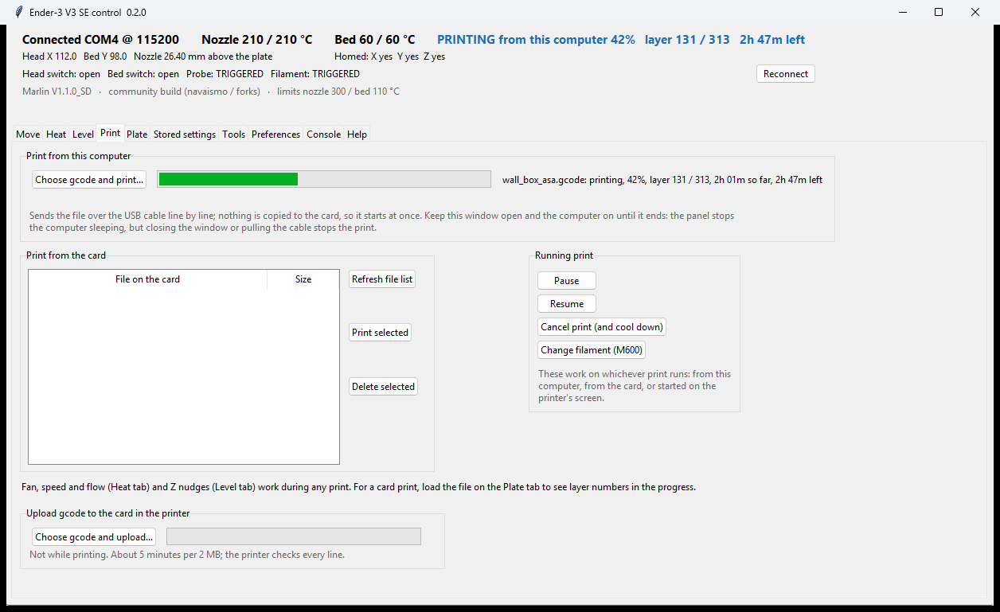
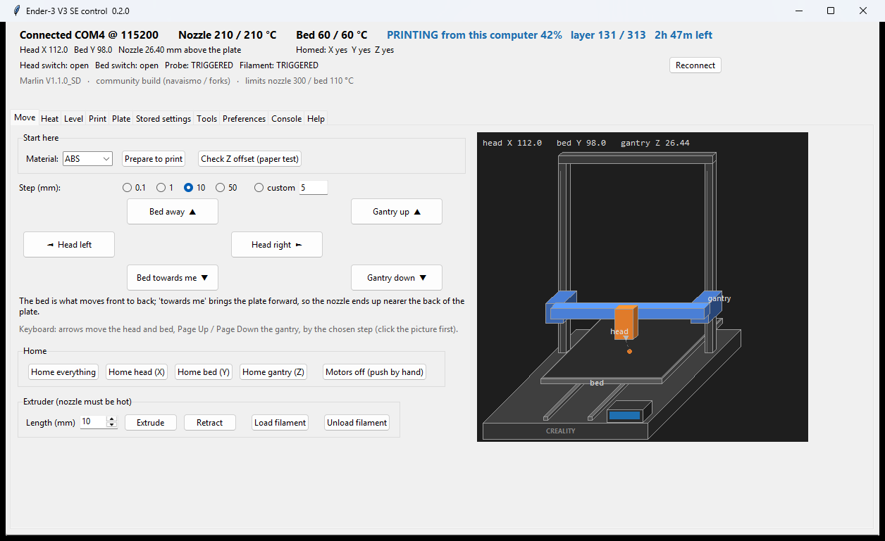
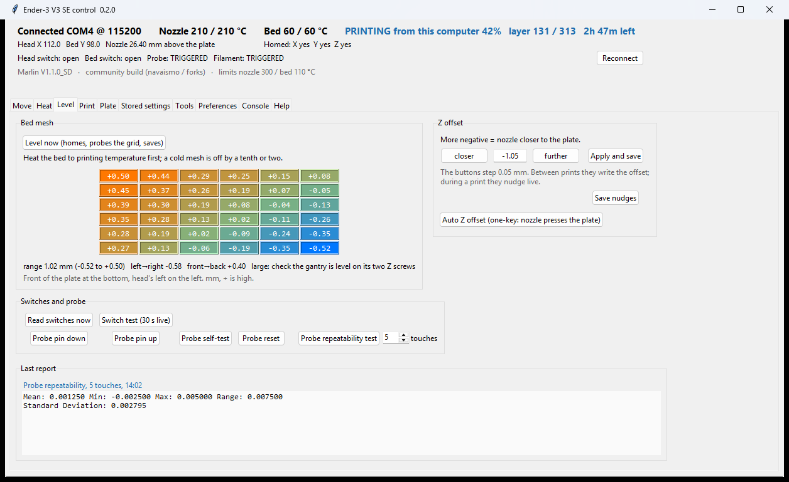
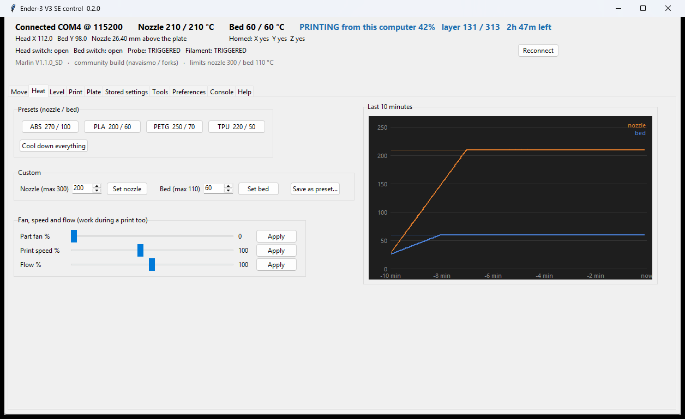
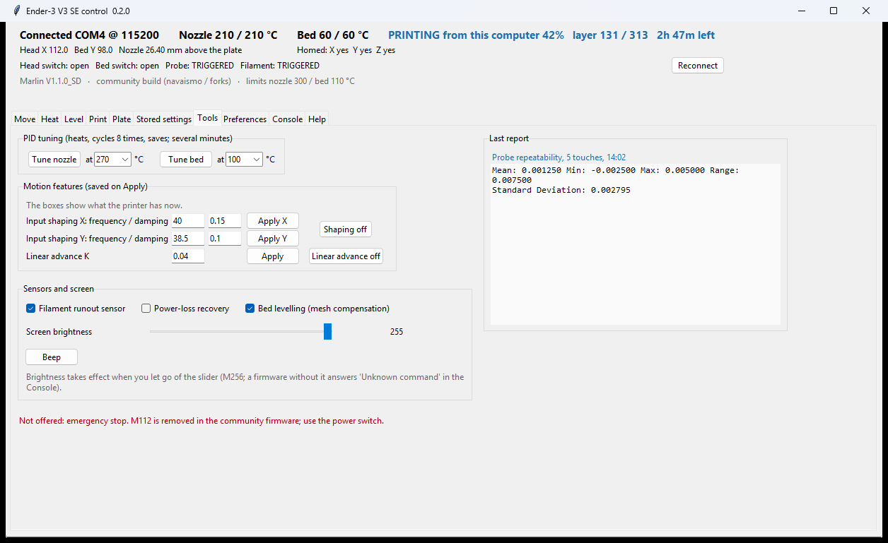
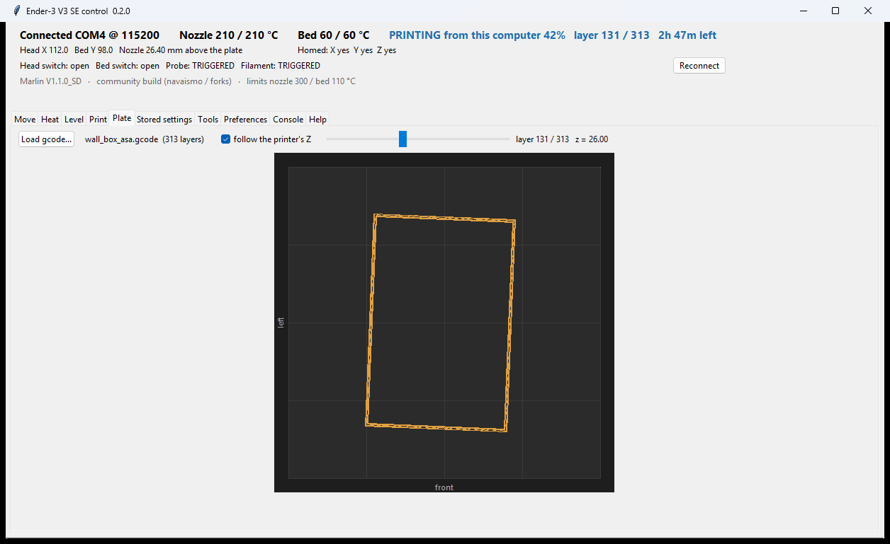

# Ender-3 V3 SE control panel

A desktop panel for the Creality Ender-3 V3 SE over the USB cable, for Windows and Linux. Buttons
are named for what moves (head, bed, gantry), every control has a plain-language hint, and the
things that usually need a terminal (levelling, Z offset, PID tuning, settings backup, sending a
file to the card) are one click each. It can also print a file straight from the computer. No
server, no browser, no account: a Python window talking to the printer's serial port.

Works with the stock Creality firmware and with the community Marlin builds
([navaismo](https://github.com/navaismo/Ender-3V3-SE) and forks). The panel reads the firmware
name on connect and sets the temperature limits accordingly.

## Screens



| | |
|---|---|
|  |  |
| **Move**: jog buttons, homing, extruder, and a sketch of the printer that follows the real position. | **Level**: the bed mesh as a coloured grid, Z offset, probe tests and the last report. |
|  |  |
| **Heat**: presets, targets, fan, speed and flow, and the last 10 minutes of temperatures. | **Tools**: PID tuning, input shaping, linear advance, sensor switches and screen brightness. |
|  | |
| **Plate**: the sliced paths layer by layer, following the print. | |

## What it does

- **Move**: head left/right, bed towards/away, gantry up/down in chosen steps, keyboard jogging,
  homing per axis, motors off, extrude/retract, load/unload. A 3D sketch of the printer follows
  the real position; hovering a button lights the part it drives.
- **Start here**: *Prepare to print* heats, homes, levels with the hot bed and brings the nozzle
  to temperature in one go. *Check Z offset* puts the nozzle at height zero over the plate centre
  for the paper test, with nudge buttons and a save.
- **Heat**: material presets (editable), custom targets, part fan, print speed and flow (also
  during a print), and a 10-minute temperature graph that shows at a glance whether the heaters
  hold steady.
- **Level**: probe the plate and save the mesh, see it as a coloured grid with range and tilt
  numbers, set the Z offset (live nudges during a print, saved when it looks right), the
  printer's one-key auto Z offset, probe pin tests, repeatability test, and a 30-second live
  switch test for prints that land in the wrong place.
- **Print**:
  - **from this computer**: pick a sliced file and it starts at once, streamed over the USB
    cable. Progress, layer and time left show on the tab and in the top bar; the Plate tab
    follows the layer being sent.
  - **from the card**: list, print, delete, and **upload a gcode file onto the card in the
    printer** over USB, so the card never has to come out.
  - Pause, resume, cancel and filament change work on whichever print runs, including one started
    on the printer's screen.
- **Alert when a print ends**: a sound and a message window (plus a flashing taskbar button on
  Windows and a desktop notification on Linux) when a print finishes or stops on its own.
- **Plate**: the sliced paths of a gcode file layer by layer with the head's position on top;
  follows the printer's Z during a print.
- **Stored settings**: every value the printer keeps, with readable names and double-click edit;
  backup to a file and restore from it (do this before a firmware flash).
- **Tools**: PID tuning for nozzle and bed, input shaping, linear advance (the boxes show the
  printer's current values), switches for the runout sensor, power-loss recovery and mesh
  compensation, screen brightness, and the **Last report**: what the printer answered to the last
  PID tune or probe repeatability test.
- **Preferences**: port and speed, jog steps and speeds, presets, limits, the print-end alert,
  and a switch for the hints. **Console**: raw gcode with history and a log of everything sent
  and received. **Help**: a one-page primer for someone new to printing.

## Install on Windows

**Ready to run**: download `Ender3V3SE-panel.exe` from the
[releases page](https://github.com/twojast4ra/ender3-v3se-panel/releases), put it in a folder of
its own and run it. It writes `config.json` and a `logs` folder next to itself. Windows SmartScreen
warns because the file is not code-signed: *More info* → *Run anyway*.

**From source**:

1. Install Python 3.10 or newer from https://www.python.org/downloads/ and tick
   *Add python.exe to PATH*.
2. Download this repository (Code → Download ZIP) and unpack it anywhere.
3. Run `install.cmd` once. It installs `pyserial`, the only extra package.
4. Plug the printer into the PC with the USB-C cable, switch it on, run `start.cmd`.

Windows installs the printer's USB driver (CH340) by itself; if the panel says *printer not found
on USB*, check Device Manager for a COM port.

## Install on Linux

**Ready to run** (x86_64: Debian 12 or newer, Ubuntu 24.04 or newer, and other distributions with
glibc 2.36 or newer; `ldd --version` shows yours): download `Ender3V3SE-panel-linux-x86_64.tar.gz` from the
[releases page](https://github.com/twojast4ra/ender3-v3se-panel/releases), then:

```
tar xzf Ender3V3SE-panel-linux-x86_64.tar.gz
cd Ender3V3SE-panel
./Ender3V3SE-panel
```

Nothing else to install. `config.json` and `logs/` go next to the program, or to
`~/.config/ender3-v3se-panel/` when that folder is not writable.

**From source**: download the repository, then `./install.sh` once (it installs `python3-tk` and
`python3-serial` with apt and adds you to the `dialout` group), then `./start.sh`.

**Permission to use the USB port**: the printer shows up as `/dev/ttyUSB0`, which belongs to the
`dialout` group. Once per computer:

```
sudo usermod -aG dialout $USER
```

then log out and back in. Without it the panel says *no permission to open /dev/ttyUSB0*.

If `/dev/ttyUSB0` appears and vanishes again a second later, the `brltty` package (Braille
displays) has claimed the printer's USB chip. Remove it if you do not use a Braille display:
`sudo apt remove brltty`.

## Both systems

Only one program can hold the serial port: close Pronterface, Cura's monitor or OctoPrint's
connection before starting the panel, and the panel before using them.

## First run

Preferences → Connection: *auto* finds the printer and tries the usual speeds. The top bar shows
the firmware it found and the temperature limits that go with it. Then Move → *Start here* →
*Prepare to print*, and watch what it does the first time.

## Printing from this computer

The file goes to the printer line by line, each with a line number and checksum, and the next
line waits for the printer's *ok*, the same way OctoPrint and Pronterface do it. A line the
printer reports as damaged is sent again; if an *ok* gets lost, the line is repeated and the
printer skips it if it already has it, so nothing runs twice.

- The computer must stay on and the panel open until the print ends. The panel stops the
  computer going to sleep while it prints (Windows: the system's own setting for this; Linux:
  `systemd-inhibit`, where it exists). Closing the window asks first, then cancels the print.
- If the cable comes out or the computer crashes, the print stops where it is and the printer
  keeps its heaters on. Switch the printer off, or reconnect and use *Cool down everything*. A
  card print does not have this weakness; use the card for long prints on a computer you need for
  other things.
- **Pause** lets the moves already sent finish, pulls the filament back 2 mm, lifts the head
  10 mm and moves it to the front left. The heaters stay on. **Resume** goes back to the same
  spot, pushes the filament forward again and restores the file's own settings (extrusion mode,
  speed). It refuses when the nozzle heater was switched off during the pause.
- **Cancel** switches the heaters and fan off, lifts the head and moves it clear.

## Notes on the firmware

- Stock Creality firmware caps the nozzle at 260 °C and the bed at 100 °C; the community builds
  allow 300 / 110. The panel uses the lower of the firmware's cap and your preference.
- Uploading to the card uses Marlin's M28/M29. The firmware demands a line number and checksum
  on every line while writing and strips comments, so the upload drops comments, which means
  uploaded files show no time or filament estimate on the printer's screen. Printing is unaffected.
  Expect about 5 minutes per 2 MB.
- Screen brightness uses M256. A firmware built without it answers *Unknown command* in the
  Console and nothing changes.
- The community build removes M112 (emergency stop). The panel offers none; the power switch is
  at the back right.
- During a print the panel only allows speed, flow, fan, Z nudges, pause, resume and cancel.

## Files

`app.py` the window · `printer.py` serial backend, printing from the computer and the action
table · `hostprint.py` reads a gcode file for printing from the computer · `desktop.py` fonts,
keep-awake and the print-end alert on Windows and Linux · `prefs.py` preferences (`config.json`,
created on first run) · `ui_help.py` hints and the Help text · `view3d.py` the printer sketch ·
`plateview.py` the gcode plate view · `tools/` small command-line helpers (read-only gcode, PID
tune, temperature hold check), the build scripts and `screens.py` for these screenshots ·
`tests/` the window against a fake printer (`smoke_test.py`) and printing from the computer
against a fake Marlin that loses replies and damages lines on purpose (`test_hostprint.py`). A
session log is written to `logs/` (switch off in Preferences).

`build_exe.cmd` makes the single Windows `.exe`; `tools/build_linux.sh` makes the single Linux
binary and its `.tar.gz`. Both use PyInstaller. Build the Linux one on the oldest system you want
it to run on: it needs that system's C library or a newer one.

## Safety

The panel refuses moves before homing, cold extrusion, jogs below Z 0, temperatures above the
firmware's limits and anything but print controls while a print runs. It cannot stop the
printer in an emergency; nothing over USB can on this firmware. Stay within reach of the power
switch during first-layer work.

## Licence

MIT. Not affiliated with Creality.
